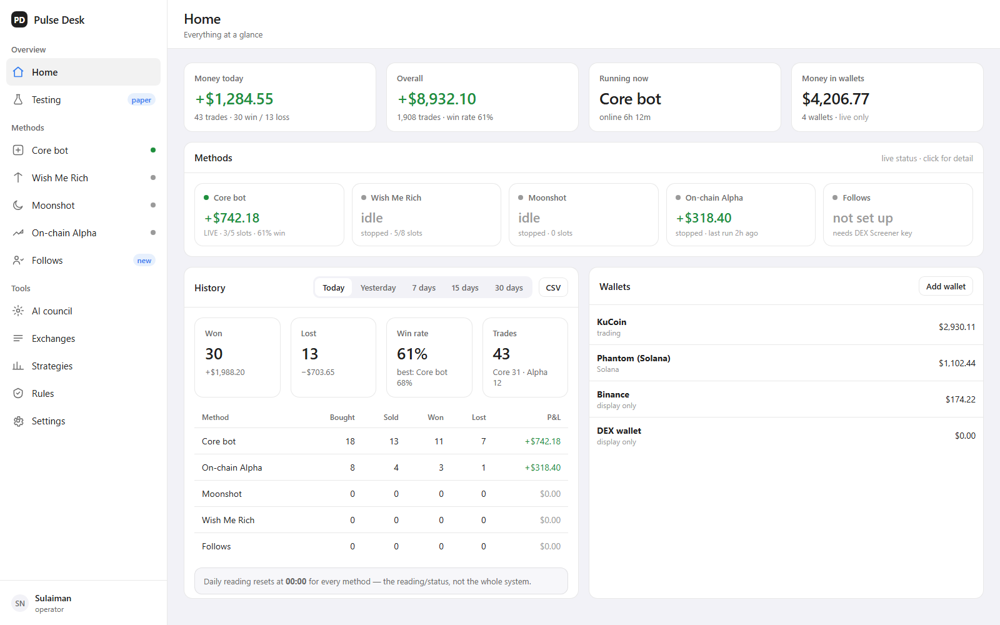

# Pulse Desk

**An operator dashboard for an automated crypto trading desk.** One screen per money method, an AI
council that votes on setups, real wallet balances, and an honest history — with paper experiments
and live money kept strictly apart.

[**▶ Live interactive demo**](https://soophere.github.io/pulse-desk-ui/) — one self-contained HTML
file, fake data, no backend needed.



## Why it exists

Automating a trading strategy is the easy part. Operating five of them at once, on several exchanges
and wallets, from a phone, without lying to yourself about the numbers, is the hard part. Pulse Desk
is the operator's single pane of glass:

- **Know what is running and what it earned** — per method, per day, live or paper.
- **Never mix paper and live money** — separate payloads, separate badges, separate numbers.
- **See the actual wallets** — exchange balances and on-chain wallets at a glance.
- **Control the desk from anywhere** — the same pages work on a laptop and on a phone over a tunnel.
- **Make destructive actions deliberate** — flatten, reset and ban flows require confirmation; write
  actions require a dashboard token.

## The demo

[`index.html`](index.html) is the complete interactive UI in a single file — no build step, no
framework, no network calls, invented data. It covers all twelve pages:

| | | | |
|---|---|---|---|
| Home | Testing (paper) | Core bot | Wish Me Rich |
| Moonshot | On-chain Alpha | Follows | AI council |
| Exchanges | Strategies | Rules | Settings |

It really works: period buttons recompute the numbers, the testing timer moves and counts paper
money, the live status dots pulse, candlestick charts redraw when you change timeframe, and modals
open on click.

## The production UI (`app/`)

`app/` is the shell of the real dashboard, as served by the desk's private service:

| File | Role |
|---|---|
| `v3.html` | shell: sidebar, top bar, page containers, modal |
| `v3.css` | design tokens (ink `#1f1f1f`, accent `#3880f0`, grouped `#f2f2f7`) and layout |
| `v3-core.js` | API client + dashboard token, 2 s status poll, formatters, canvas candles/sparklines, action dispatcher, router |
| `v3-pages.js` | renderers for all thirteen pages |

It is not runnable standalone: `v3-core.js` talks to the desk API and write actions need the
`X-Dashboard-Token` header. The trading engine, API and data are **not** part of this repository.

## Engineering notes

- **No framework, no build step.** One HTML shell, CSS custom properties, two JS modules
  (~135 KB unminified). Fast first paint on a phone, trivially cache-busted with `?v=`.
- **Charts without a chart library.** Candlesticks, volume, sparklines and the pullback signal are
  drawn on canvas.
- **Page-level test harness.** A Node harness renders every page against a captured real API payload
  and asserts on the DOM — it caught a crash on the Core and Activity pages (`clock is not defined`),
  an invalid CSS selector in an inline handler, and a chart poll that kept running after its modal
  closed.
- **Paper and live are separated in data, not just labels** — different endpoints, different
  payloads, different badges. Live numbers never leak into a paper view.
- **Deploy without touching the running bot.** Static files are swapped over SSH and `scp`; a small
  flip script makes the new UI the front page, and the old one stays reachable. No service restart,
  no risk to an open position.
- **Designed flat** — solid source-list sidebar, grouped background, solid cards, mono numerals, no
  blur, glass, floating cards or drop shadows.

## Stack

| Layer | Technology |
|---|---|
| UI | Vanilla HTML / CSS / JS, canvas — served as static files by the desk service |
| Desk service | Python (private) |
| AI council | Several LLM voters routed through an OpenAI-compatible local router |
| Deployment | Proxmox LXC, static hot-swap, phone access over a mesh VPN |

The AI council page is the operator's control panel for the model voters: add keys, refresh the
model list, and test each voter individually. One deliberately broken voter is part of the test —
the point of the button is to show which voters cannot answer.

## Run the demo locally

```powershell
# from the repo root
python -m http.server 8080
# then open http://localhost:8080/
```

Or just open `index.html` in a browser.

## Layout

```
index.html            interactive demo (single file)
screenshots/          rendered pages (1600×1000)
app/                  production UI source (shell + modules)
docs/design.md        design decisions and UI principles
```

## Notes

- The demo data is invented. Several amounts, coins, wallets and counts are placeholders.
- No game-able claims: this repo contains **no trading logic, no strategies, no keys, no API
  endpoints** — only the operator interface.
- Built iteratively with [DeepSeek Harness](https://github.com/deepseek-ai/deepseek-harness) as the
  coding agent; every change was verified against a captured live payload before deploy.

## License

MIT — see [LICENSE](LICENSE). If you use this UI, keep the attribution.
